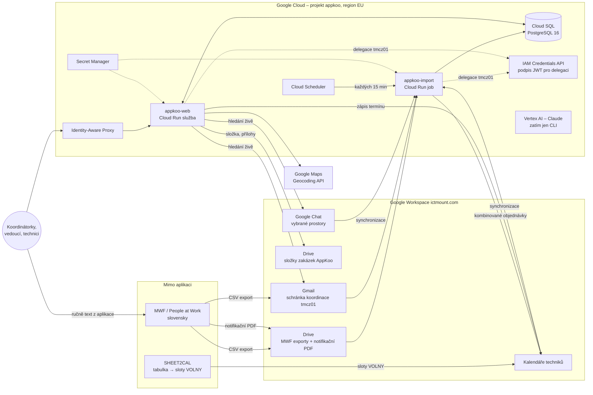
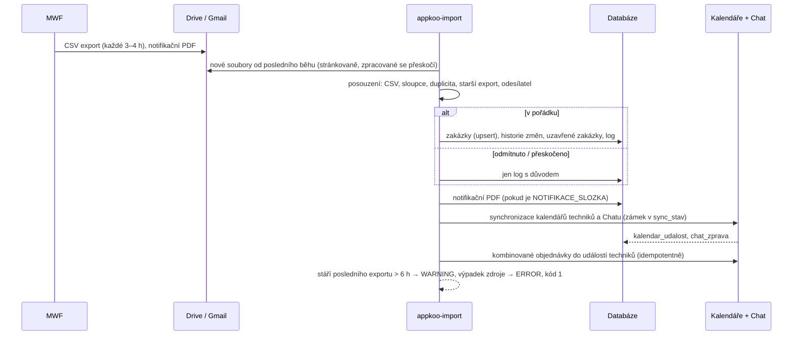
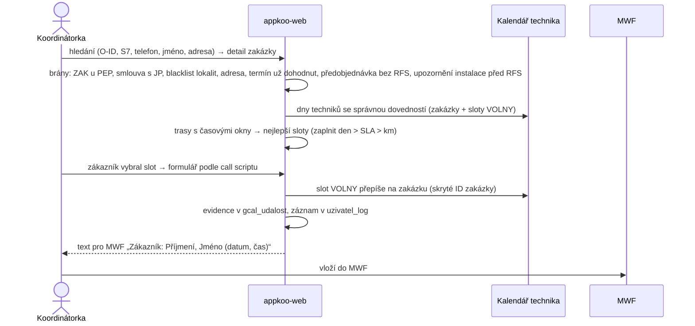
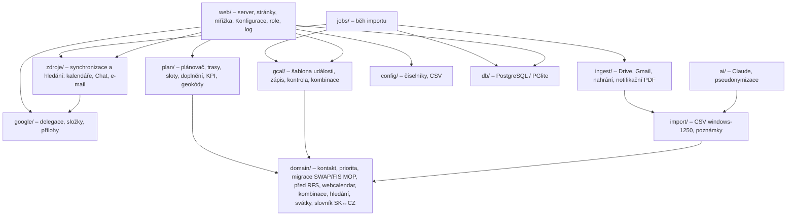

# Architektura systému appkoo

Verze: 13.11.2026 (aktualizace podle kódu ve větvi `faze1`; původní verze 15.10.2026)
· navazuje na `docs/faze1.md` (zadání fáze 1), `docs/architektura-gcp.md` (provoz v Google Cloudu)
a `docs/workflow.md` (proces v kódu)

Cíl: **automatický příjem MWF exportu**, **všechno o zakázce na jedné obrazovce** (MWF, e-mail, Chat,
kalendáře, notifikační PDF), **propojení s kalendáři techniků** (méně chyb při přepisu) a **optimalizace
plánování** (režim A zakázka → slot, režim B slot → zakázky, trasy s časovými okny, SLA).
MWF zůstává hlavní evidencí, zápis do MWF dělá koordinátorka. Volná okna techniků generuje dál
SHEET2CAL mimo aplikaci – aplikace je jen čte a obsazuje.

## 1. Přehled

## 2. Komponenty

Stav: **PROVOZ** = nasazeno a běží · **KÓD** = hotovo a otestováno, čeká na nasazení nebo nastavení · **PLÁN** = zatím není.

| Komponenta | Služba | Co dělá | Kód | Stav |
|---|---|---|---|---|
| Import MWF exportu | Cloud Run job `appkoo-import`, Scheduler každých 15 min | nové exporty z Drive (a Gmailu) → posouzení (formát, sloupce, duplicita, starší export, odesílatel) → zakázky, historie, uzavřené zakázky, log; hlídá stáří exportu (> 6 h = varování) | `src/jobs/`, `src/ingest/prijem.ts`, `src/ingest/google.ts`, `src/import/`, `src/db/` | PROVOZ (Drive); e-mail KÓD – čeká na delegaci |
| Notifikační PDF | součást importu | PDF `<MWF ID aktivity>.pdf` → instalační předpis, režim KZ, kompatibilní zařízení, řádky „Priebeh optický“ s akcí Vytvoriť (`pdftotext`, poppler v image) | `src/ingest/notifikace.ts`, `src/ingest/priebeh.ts` | KÓD (zapíná `NOTIFIKACE_SLOZKA`) |
| Synchronizace kalendářů a Chatu | součást importu (zámek proti souběhu) | události kalendářů techniků a zprávy z vybraných prostorů Chatu do DB, aby web nečekal na Google; po ní propsání kombinovaných objednávek (FTTH + IPTV / MESH) do událostí techniků | `src/zdroje/sync.ts`, `src/gcal/kombinaceKalendar.ts` | KÓD (zapíná `DELEGACE_UZIVATEL` + `SERVISNI_UCET`) |
| Webová aplikace | Cloud Run služba `appkoo-web` za IAP, `node:http`, HTML ze serveru bez JS na klientu | fronta k volání, hledání, detail zakázky ze všech zdrojů, Plánovat zakázku (režim A), Doplnit technika (režim B), Kalendář techniků (mřížka), zápis termínu, složka a přílohy zakázky, Konfigurace, historie uživatelů | `src/web/` | PROVOZ (fronta + detail); plánování a zápis KÓD (pilot) |
| Hledání ve všech zdrojích (pilíř 1) | součást webu | MWF z DB; kalendáře a Chat z DB (záloha: paměť instance obnovovaná po 5 min); e-mail živě v Gmailu; každý zdroj s vlastním limitem a chybou | `src/zdroje/hledani.ts`, `src/domain/hledani.ts` | KÓD |
| Plánovač | součást webu | brány zlatých pravidel, dny techniků z kalendáře, TSP s časovými okny, nabídka slotů (zaplnit den > SLA > km), doplnění slotu kandidáty vč. přesunu „flex“, KPI | `src/plan/` | KÓD |
| Zápis do kalendáře | součást webu | formulář podle call scriptu → přepis slotu VOLNY na zakázku (skryté ID zakázky, patička SHEET2CAL zůstane, obsazený slot se nepřepíše); při přesunu vrácení původní události na VOLNY; text „Zákazník: …“ pro MWF | `src/gcal/udalost.ts`, `src/gcal/kalendar.ts`, `src/web/planovani.ts` | KÓD – zapíná `ZAPIS_KALENDARE=ano` + `ZAPIS_TECHNICI` |
| Kontrola MWF ↔ kalendář | knihovna | technik, den, čas (±30 min), adresa (≥ 80 %), telefon; rozpoznání VOLNY / NEPLANOVAT | `src/gcal/kontrola.ts` | KÓD (logika); samostatný job s tabulkou rozporů PLÁN |
| Složky a přílohy zakázky | součást webu | složka „AppKoo O-…“ na Disku (rok / týden) na tlačítko; vybrané fotky a PDF z Chatu a e-mailu se uloží do složky | `src/google/slozky.ts`, `src/google/prilohy.ts` | KÓD |
| Vytěžení poznámek | knihovna + CLI | změněné poznámky bez osobních údajů → Claude → návrh stavu, blokací, dalšího kroku; při výpadku deterministické vyhodnocení | `src/ai/`, `npm run claude:test` | KÓD; zapojení do jobu nebo webu PLÁN |
| Databáze | Cloud SQL PostgreSQL 16 (db-f1-micro); v testech PGlite | viz kap. 5 | `db/schema.sql`, `src/db/` | PROVOZ |
| Přihlášení a role | IAP (celá doména `ictmount.com`) + číselník Uživatelé | role správce / koordinátorka / jen čtení / technik; správci ze `SPRAVCI` vždy; volitelně ověření podpisu IAP (`IAP_AUDIENCE`) | `src/web/uzivatele.ts`, `src/web/server.ts` | PROVOZ |
| Tajné údaje | Secret Manager | `DATABASE_URL`, `GOOGLE_MAPS_API_KEY` (Claude přes Vertex AI klíč nepotřebuje) | – | PROVOZ (DB); klíč Maps čeká |
| Logy a upozornění | Cloud Logging / Monitoring | job píše JSON řádky se `severity`; výpadek zdroje = kód 1 → upozornění | `src/jobs/run.ts`, `src/web/log.ts` | KÓD; upozornění v Monitoringu PLÁN |

## 3. Hlavní toky

### 3.1 Import (Cloud Run job, každých 15 min)

Výpadek jedné části (PDF, kalendáře, Chat) se jen zaloguje a nezastaví import exportů.

### 3.2 Plánovat zakázku (režim A: zakázka → slot)

Přesun zakázky: nový slot se obsadí a původní událost se vrátí na zelený slot VOLNY.

### 3.3 Doplnit technika (režim B: slot → zakázky)

`/technik` → den → technici od nejméně vytížených → volný slot → kandidáti: otevřené zakázky bez termínu,
které projdou branami (P1–P3, správná dovednost), a naplánované zakázky s poznámkou „flex“, pokud jde
o přesun dopředu. Řazení: naléhavost SLA a priorita, pak km navíc oproti trase dne; zajížďka nad limitem
(výchozí 75 km, Konfigurace → Nastavení plánování) se nenabízí. Zápis pak stejně jako v 3.2.

## 4. Vrstvy kódu

Doménová vrstva (`domain/`) nezávisí na Googlu ani na databázi – pravidla jdou testovat samostatně.
Dnes 215 automatických testů ve 30 souborech (`npm test`, bez sítě a bez API klíčů; databáze v PGlite).

## 5. Data

| Tabulka | Obsah |
|---|---|
| `import_run` | každý došlý soubor: cesta, odesílatel, otisk, čas exportu, výsledek, důvod |
| `zakazka` | aktuální stav zakázky z posledního exportu (vč. kombinovaných objednávek); `uzavreno` = zmizela z exportu |
| `zakazka_historie` | změny stavu, parkování, termínu a technika mezi exporty |
| `pokus` | pokusy o kontakt zapsané v aplikaci (z MWF se dopočítávají z poznámek) |
| `note_eval` | návrhy Claude a opravy koordinátorek |
| `ciselnik_polozka`, `ciselnik_zmena` | číselníky z Konfigurace (technici, uživatelé, blacklist, pravidla priority, nastavení plánování…) a historie změn |
| `geokod` | souřadnice adres (každá adresa se geokóduje jen jednou) |
| `gcal_udalost` | události, které v kalendáři techniků vytvořila aplikace (vazba zakázka ↔ událost) |
| `kalendar_udalost` | synchronizované události všech kalendářů techniků (pro hledání, detail, mřížku, plánování) |
| `chat_zprava` | synchronizované zprávy z vybraných prostorů Chatu |
| `sync_stav` | stav a zámek synchronizace (opuštěný zámek po 15 min vyprší) |
| `notifikace_pdf` | vytěžená notifikační PDF z MWF |
| `slozka_zakazky`, `soubor_zakazky` | složka zakázky na Disku a přílohy do ní uložené |
| `uzivatel_log` | historie aktivit uživatelů (hledání, otevření zakázky, zápis, Konfigurace, odepřený přístup); mazání po 180 dnech |

## 6. Přístup ke Google Workspace

| Co | Jak | Rozsah |
|---|---|---|
| Složka MWF exportů a notifikačních PDF | nasdílená servisnímu účtu `appkoo-runner` (čtenář), přihlášení ADC | `drive.readonly` |
| Kalendáře techniků – zápis | nasdílené servisnímu účtu s právem „Provádět změny v událostech“ | `calendar.events` |
| E-mail, kalendáře, Chat – čtení | delegace v rámci domény jménem `tmcz01`; Cloud Run nemá klíč – JWT podepisuje IAM Credentials API (`signJwt`) | `gmail.readonly`, `calendar.readonly`, `chat.messages.readonly`, `chat.spaces.readonly` |
| Složky zakázek, přílohy | delegace jménem `tmcz01` | `drive` |
| Schránka s exporty (volitelně) | delegace, kvůli štítku „zpracováno“ | `gmail.modify` |

## 7. Bezpečnost a osobní údaje

- Vše v jednom GCP projektu v EU. IAP pouští doménu `ictmount.com`, o přístupu a roli rozhoduje číselník Uživatelé;
  zápis do kalendářů je navíc vypínač (`ZAPIS_KALENDARE`) a seznam povolených techniků (`ZAPIS_TECHNICI`).
- Servisní účet má minimum práv; delegace jen pro jeden účet (`tmcz01`) a vyjmenované scopy.
- Aplikace jen čte e-mail a Chat; e-maily na interní skupiny (`INTERNI_SKUPINY`, výchozí `cml@ictmount.com`) se nezobrazují.
- Přílohy z Chatu a e-mailu se do složky zakázky ukládají jen na výběr koordinátorky, nic se nekopíruje automaticky.
- Do Claude jdou poznámky bez jmen, telefonů a e-mailů; Claude přes Vertex AI v regionu EU.
- E-mail s exportem se přijme jen od povolených odesílatelů; každý příjem, každá změna číselníku a každá
  významná akce uživatele je v historii.
- MWF exporty ani PDF se nikdy neukládají do repozitáře (`*.csv` v `.gitignore`).

## 8. Konfigurace (proměnné prostředí)

| Proměnná | Job | Web | Význam |
|---|:-:|:-:|---|
| `DATABASE_URL` | ✓ | ✓ | připojení k Cloud SQL (secret) |
| `MWF_SLOZKA` | ✓ | | ID složky s MWF exporty |
| `NOTIFIKACE_SLOZKA` | ✓ | ✓ | ID složky s notifikačními PDF |
| `GMAIL_SCHRANKA`, `POVOLENI_ODESILATELE` | ✓ | | příjem exportu e-mailem |
| `STARY_EXPORT_HODIN` | ✓ | | limit pro varování o starém exportu (výchozí 6) |
| `DELEGACE_UZIVATEL`, `SERVISNI_UCET` | ✓ | ✓ | delegace (tmcz01, appkoo-runner) |
| `CHAT_PROSTORY` | ✓ | ✓ | prostory Chatu, čárkami |
| `SPRAVCI`, `POVOLENI_UZIVATELE`, `IAP_AUDIENCE` | | ✓ | přístup a role |
| `ZAPIS_KALENDARE`, `ZAPIS_TECHNICI` | | ✓ | zapnutí zápisu do kalendářů |
| `GOOGLE_MAPS_API_KEY` | | ✓ | geokódování (secret) |
| `INTERNI_SKUPINY` | | ✓ | e-mailové skupiny skryté v detailu |
| `CLAUDE_PROVIDER`, `CLAUDE_VERTEX_REGION`, `GOOGLE_CLOUD_PROJECT` | ✓ | | Claude přes Vertex AI |
| `DEV_USER` | | ✓ | jen lokální vývoj bez IAP |

## 9. Co chybí do plného provozu

1. Nasadit plánování a zápis do kalendáře (pilot: `ZAPIS_KALENDARE=ano`, vybraní technici v `ZAPIS_TECHNICI`).
2. Delegace v adminu Workspace pro Client ID servisního účtu (e-mail, Chat, kalendáře, Disk) a nastavit
   `DELEGACE_UZIVATEL`, `SERVISNI_UCET`, `CHAT_PROSTORY`; klíč Google Maps do Secret Manageru.
3. Nahrání exportu MWF přímo ve webu (cesta `prijmiSoubory()` je hotová, chybí stránka).
4. Kontrola MWF ↔ kalendář jako pravidelná úloha s tabulkou rozporů a upozorněním.
5. Zapojit vytěžení poznámek přes Claude do importu (jen změněné poznámky) a zobrazit návrhy v detailu.
6. Fulltext přes e-mail (dnes se hledá živě v Gmailu) – návrh ukládat do DB, čeká na potvrzení.
7. Upozornění v Cloud Monitoringu (neúspěšný job, starý export) a infrastruktura jako kód (Terraform).
