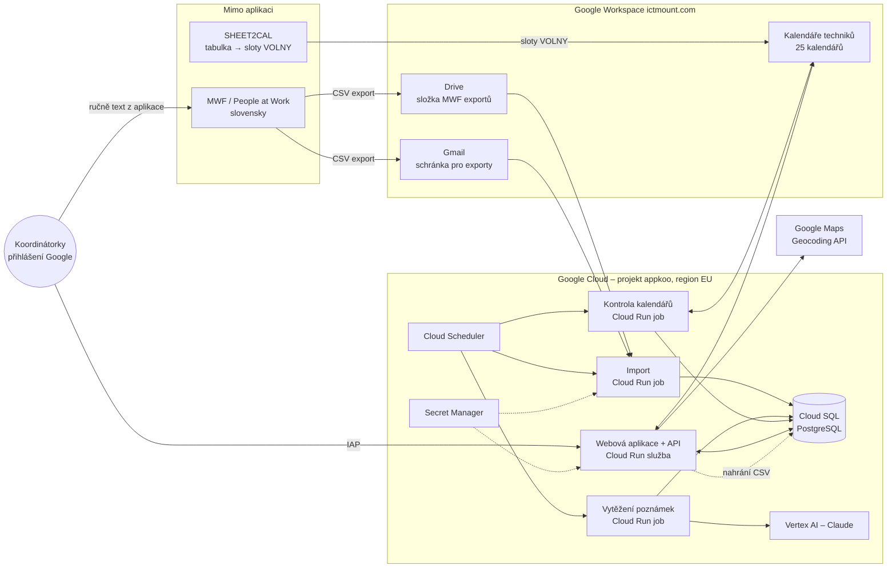
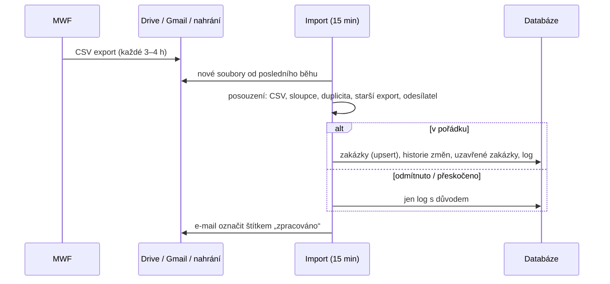
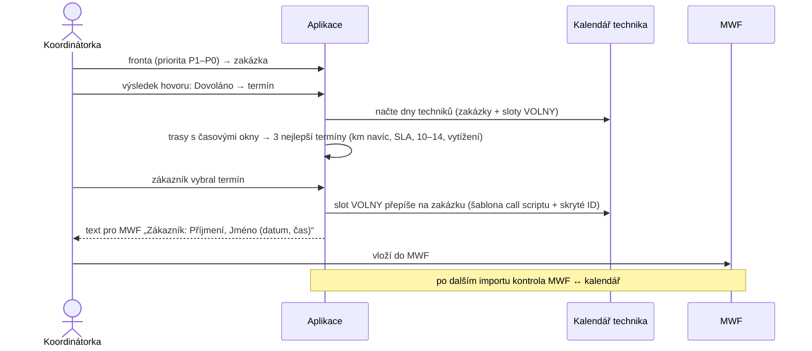
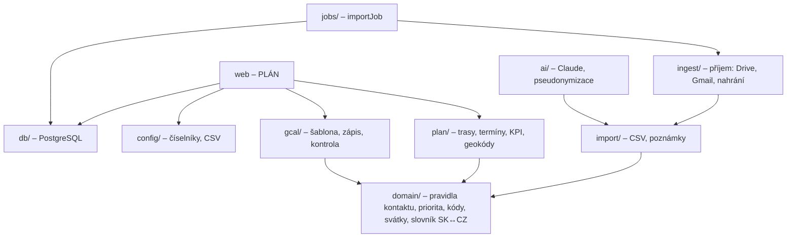

# Architektura systému appkoo

Verze: 15.10.2026 · navazuje na `docs/architektura-gcp.md` (provoz v Google Cloudu) a `docs/workflow.md` (proces v kódu)

Cíl: **automatický příjem MWF exportu**, **propojení s kalendáři techniků** (méně chyb při přepisu)
a **optimalizace plánování** (trasy s časovými okny, KPI zakázky). MWF zůstává hlavní evidencí,
zápis do MWF dělá koordinátorka. Volná okna techniků generuje dál SHEET2CAL mimo aplikaci.

## 1. Přehled

## 2. Komponenty

| Komponenta | Služba | Co dělá | Kód | Stav |
|---|---|---|---|---|
| Import | Cloud Run job, každých 15 min | vezme nové exporty z Drive a Gmailu, posoudí (formát, sloupce, duplicita, starší export), uloží zakázky, historii, uzavřené zakázky | `src/jobs/importJob.ts`, `src/ingest/`, `src/import/`, `src/db/` | KÓD |
| Kontrola kalendářů | Cloud Run job, po importu | porovná termíny MWF s kalendáři (technik, den, čas, telefon, adresa), uloží rozpory | `src/gcal/kontrola.ts`, `src/gcal/kalendar.ts` | KÓD (logika), PLÁN (job + tabulka rozporů) |
| Vytěžení poznámek | Cloud Run job, po importu | jen změněné poznámky → Claude (bez jmen a telefonů) → návrh stavu, blokací, dalšího kroku | `src/ai/` | KÓD (logika), PLÁN (job) |
| Webová aplikace | Cloud Run služba za IAP | fronta, výsledek hovoru, nabídka termínů, zápis do kalendáře, Konfigurace, nahrání exportu | – | NÁVRH (prototyp), PLÁN |
| Plánovač | součást webu | dny techniků z kalendáře, trasa s časovými okny, nabídka termínů podle km, SLA a priority, KPI | `src/plan/` | KÓD |
| Databáze | Cloud SQL PostgreSQL 16 | zakázky, historie, log importu, číselníky, geokódy, události v kalendářích, vytěžení Claude | `db/schema.sql` | KÓD |
| Tajné údaje | Secret Manager | klíč Google Maps (Claude přes Vertex AI klíč nepotřebuje) | – | PLÁN |
| Přihlášení | Identity-Aware Proxy | jen účty `@ictmount.com`, role vedoucí / operátorka | `src/config/` (role v číselníku) | PLÁN |
| Logy a upozornění | Cloud Logging / Monitoring | e-mail, když import selže nebo > 6 h nepřišel export | – | PLÁN |

## 3. Hlavní toky

### 3.1 Příjem exportu

### 3.2 Domluvení termínu

Přesun zakázky: nový slot se obsadí a původní událost se vrátí na zelený slot VOLNY.

## 4. Vrstvy kódu

Doménová vrstva (`domain/`) nezávisí na Googlu ani na databázi – pravidla jdou testovat samostatně
(dnes 88 automatických testů).

## 5. Data

| Tabulka | Obsah |
|---|---|
| `import_run` | každý došlý soubor: cesta, odesílatel, otisk, výsledek, důvod |
| `zakazka` | aktuální stav zakázky z posledního exportu; `uzavreno` = zmizela z exportu |
| `zakazka_historie` | změny stavu, parkování, termínu a technika mezi exporty |
| `gcal_udalost` | vazba zakázka ↔ událost v kalendáři technika |
| `geokod` | souřadnice adres (každá adresa se geokóduje jen jednou) |
| `ciselnik_polozka`, `ciselnik_zmena` | číselníky z Konfigurace a historie jejich změn |
| `note_eval` | návrhy Claude a opravy koordinátorek |
| `pokus` | pokusy o kontakt zapsané v aplikaci |

## 6. Bezpečnost a osobní údaje

- Vše v jednom GCP projektu v EU; přístup jen přes Google účty `@ictmount.com` (IAP), role vedoucí / operátorka.
- Aplikace běží pod servisním účtem s minimem práv: složka exportů jen ke čtení, kalendáře techniků „měnit události“, čtení schránky přes delegaci jen pro jednu schránku.
- Do Claude jdou poznámky bez jmen, telefonů a e-mailů; Claude přes Vertex AI v regionu EU.
- E-mail s exportem se přijme jen od povolených odesílatelů; každý příjem a každá změna číselníku je v historii.
- MWF exporty se nikdy neukládají do repozitáře.

## 7. Co chybí do provozu

1. Webová aplikace a API (fronta, nabídka termínů, zápis do kalendáře, Konfigurace, nahrání exportu).
2. Joby kontroly kalendářů a vytěžení poznámek, tabulka rozporů a upozornění.
3. Nasazení: Dockerfile, Cloud Run, Cloud SQL, Scheduler, IAP, Secret Manager (ideálně jako Terraform).
4. Od vás: GCP projekt a správce, nasdílení složky exportů a kalendářů servisnímu účtu, klíč Google Maps,
   adresy výjezdu techniků, chování SHEET2CAL k už změněným událostem.
