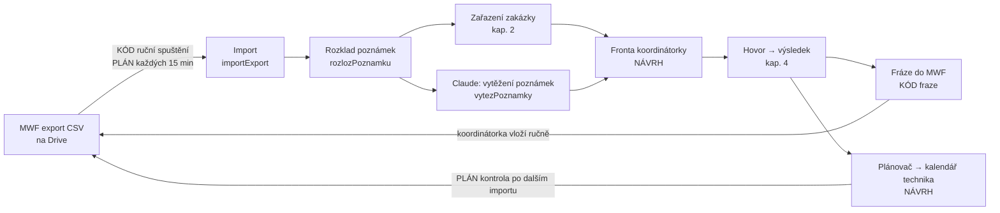
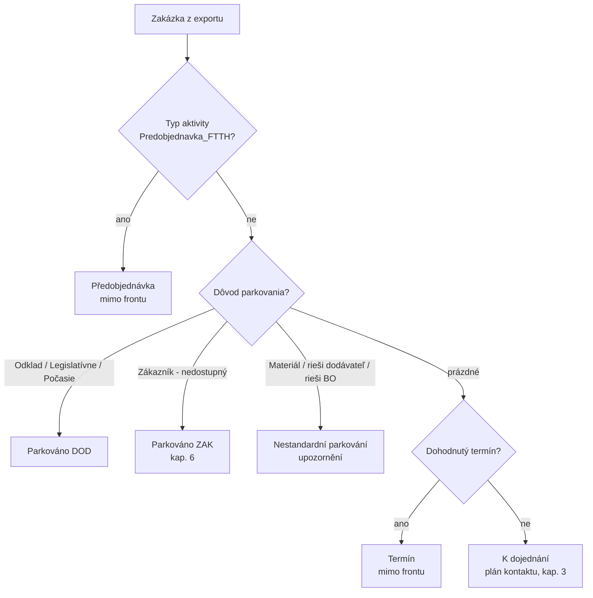
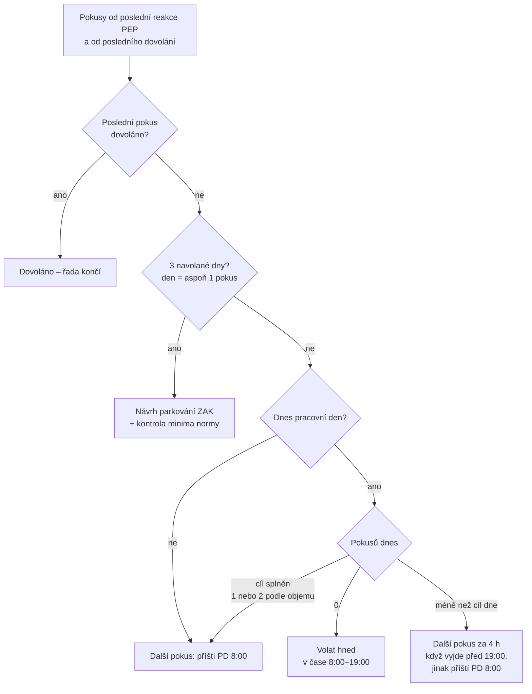
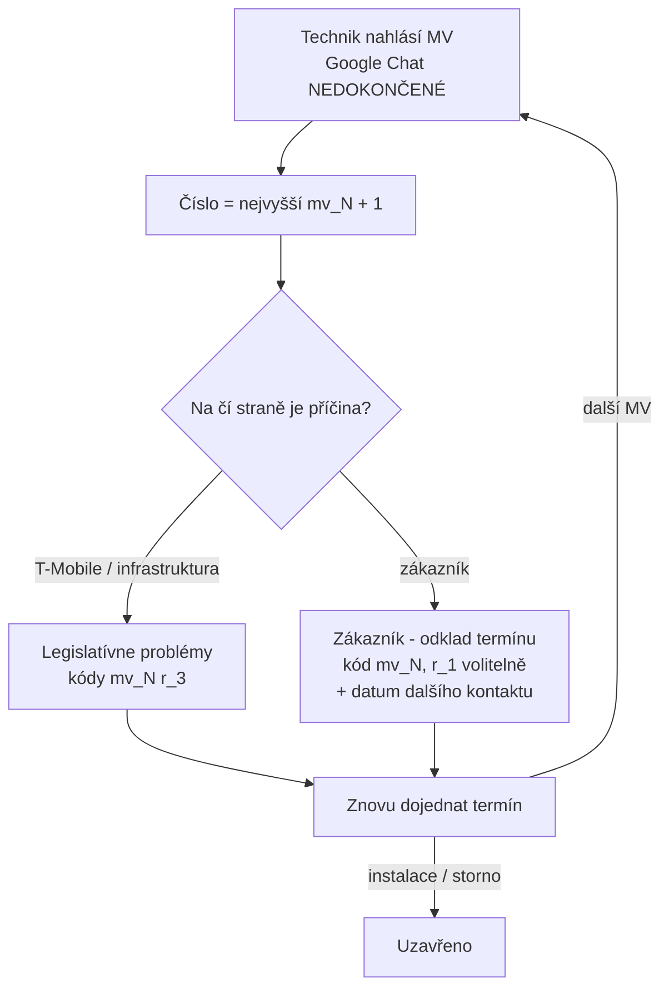
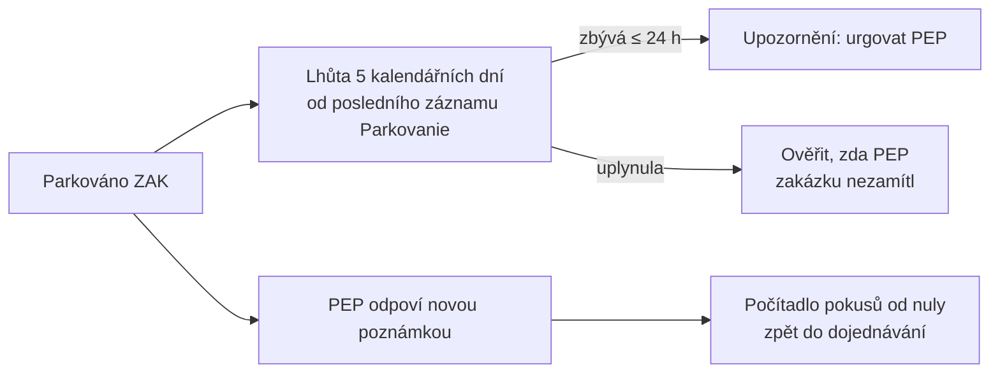
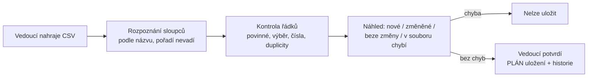

# Workflow aplikace – jak ho dnes implementuje kód

Verze: 15.10.2026 · odvozeno z kódu ve větvi `claude/dashboard-planning-app-6gcm7h` (commit f764b79)

Stav kroků: **KÓD** = naprogramováno a otestováno · **NÁVRH** = jen v klikacím návrhu ·
**PLÁN** = zatím není.

## 1. Přehled

| Krok | Funkce | Stav |
|---|---|---|
| Načtení CSV (windows-1250, `;`) | `src/import/csv.ts` | KÓD |
| Převod řádku na zakázku | `importExport` | KÓD |
| Rozklad poznámky na záznamy `[Typ] datum, autor: text` | `rozlozPoznamku` | KÓD |
| Vytěžení poznámek přes Claude (bez jmen a telefonů) | `vytezPoznamky` | KÓD, spouští se ručně (`--ai`), výsledek se zatím neukládá |
| Příjem exportu: e-mail, nahrání v aplikaci, Google Drive (kontrola, duplicity, starší export) | `src/ingest/` | KÓD, bez spouštění v cloudu |
| Priorita P1–P0 podle pravidel z Konfigurace | `urciPrioritu` | KÓD |
| Ukládání do databáze, plánované spouštění | – | PLÁN |
| Fronty, plánovač, zápis do kalendáře | – | NÁVRH |

## 2. Zařazení zakázky po importu

Co si import u zakázky zjistí (`importExport`):
- číslo O- (ze sloupce *ID obj. v ext. systéme*) a jeho základ bez přípon `:1`, `-13075814`,
- infrastrukturu podle *P17: Vlastník siete* a typu aktivity: TMCZ / CETIN / VDF,
- termín; když MWF vypíše jen čas (`11:00 / 12:59`), bere se den exportu,
- *Do splnění* v minutách (`-41t,5d,1h,15m`, t = týdny),
- počet marných výjezdů = nejvyšší `mv_N` v poznámkách.

## 3. Kontaktování zákazníka (`planKontaktu`)

Pokusy se berou z poznámek (`pokusyZPoznamky`):
- jen zápisy typu *Dojednávania* a *Editácia*,
- jen **po posledním zápisu autora bez „(Vegacom)“** – to je reakce PEP a nuluje počítadlo,
- **nedovoláno** = text obsahuje *nezved, nedovol, nezasti, nebere, nedostupn, mimo provoz, vytípnut, bez reakce*;
  SMS = ve stejném zápisu slovo *sms*,
- **dovoláno** = *spojeno, dovoláno, domluven, dohodnut, na přání, na žádost, potvrzuje, souhlasí*
  nebo řádek `Zákazník: … (datum)`,
- souhrnný zápis při parkování ZAK (*dle pravidel*, *součinnost PEP*) se nepočítá.

SMS: aplikace doporučí SMS, když byl dnes nedovolaný pokus, dnes ještě žádná SMS neodešla a od
poslední SMS uběhlo aspoň 18 h (okno 8:00–22:00, pracovní dny).

Upozornění: vynechaný pracovní den v řadě · první pokus dne po 15:00 · po 3 PD méně než 2 SMS
s odstupem 18 h · návrh ZAK, ale pokusy nesplňují minimum normy (3 pokusy s odstupem 4 h, 2 SMS).

Pracovní den = Po–Pá bez státních svátků ČR včetně Velkého pátku a Velikonočního pondělí.

## 4. Výsledek hovoru → fráze a parkování (`fraze`, `parkovaniPoMv`)

| Výsledek | Fráze do MWF | Kód | Parkování | Výsledok dojednávania |
|---|---|---|---|---|
| Nedovoláno | `zkz. nezvedá tlf., sms` / `zkz. nezvedá tlf.` | – | – | Nezastihnutý |
| Odklad | `na přání kontaktovat DD.MM.RRRR r_1` | r_1 | Zákazník - odklad termínu | Odklad |
| Smlouva s JP | `zkz. má smlouvu s JP, ověřuje si výpovědní dobu, přeje si kontaktovat DD.MM.RRRR r_2` | r_2 | Zákazník - odklad termínu | Odklad |
| Termín na přání | `na přání zákazníka instalace dne DD.MM.RRRR r_1` | r_1 | – | Dohodnutý termín |
| Termín | `Zákazník: Příjmení, Jméno (DD.MM.RRRR, HH:MM - HH:MM)` | – | – | Dohodnutý termín |
| ZAK nedostupný | `zkz. nedostupný, kontaktován dle pravidel 3 prac. dny (OD–DO), N× tlf., N× sms – prosíme o součinnost PEP` | r_1 | Zákazník - nedostupný | Nezastihnutý |

Fráze, kódy a parkování: KÓD. Tlačítka v obrazovce: NÁVRH.

## 5. Marný výjezd (`parkovaniPoMv`)

Výpočet čísla mv a parkování: KÓD. Čtení Google Chatu: PLÁN.

## 6. ZAK a PEP (`lhutaZak`)

## 7. Konfigurace – číselníky (`nahledImportu`, `exportCsv`)

Číselníky s CSV: technici, typy akcí, koordinátorky, regiony, blokované lokality, kontakty (KÓD).
Sloupce, které v CSV nejsou, se u existujících řádků nemění. Řádky chybějící v CSV se jen nahlásí.

## 8. K ověření s realitou

1. **Slova v poznámkách.** Pozná kód pokus správně podle výrazů v kap. 3? Chybí nějaký, který koordinátorky běžně píšou?
2. **Reset počítadla.** Nuluje ho každý zápis autora bez „(Vegacom)“. Jsou v poznámkách i jiní autoři než PEP (BO, systém MWF), u kterých by se nulovat nemělo?
3. ~~Dva pokusy dnes blíž než 4 h.~~ **Vyřešeno 15.10.:** den je navolaný už s 1 pokusem, počet pokusů denně (1/2/auto podle objemu) je v Konfiguraci.
4. **Tři dny po sobě.** Kód vyžaduje 3 kompletní dny, ale přerušenou řadu jen hlásí. Má se po vynechaném dni začít znovu od dne 1?
5. **Předobjednávky.** Pravidlo priority `predobjednavka_po_rfs` je dává od data RFS do P1 – ověřit, zda je volat už pár dní před RFS (parametr).
6. **Termín v minulosti.** Pravidlo `termin_probehl` ji dá do P1 – ověřit, že tak má být.
7. **Lhůta ZAK.** Počítá se od posledního záznamu `[Parkovanie]`. Zapisuje MWF tento záznam při každém zaparkování?
8. ~~Priorita P1–P0.~~ **Vyřešeno 15.10.:** pravidla priority jsou číselník v Konfiguraci (i CSV), výpočet `urciPrioritu`.
9. **Blacklist lokalit.** Zatím je hlídá jen Claude podle textu, kontrola adresy proti číselníku chybí.
